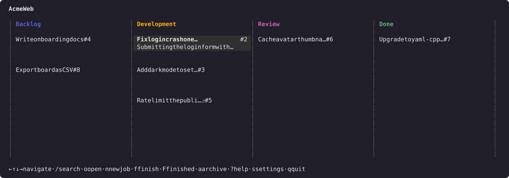
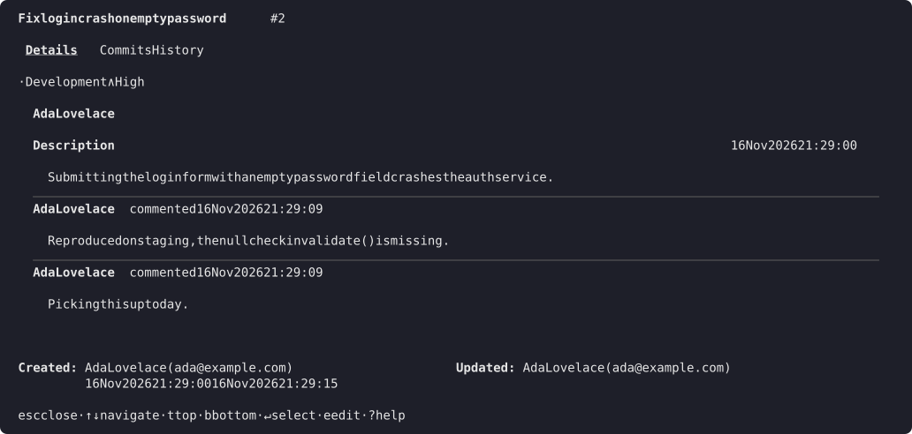
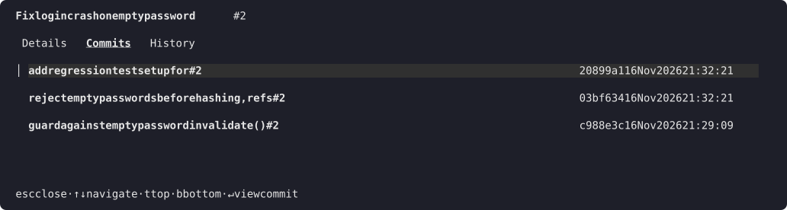
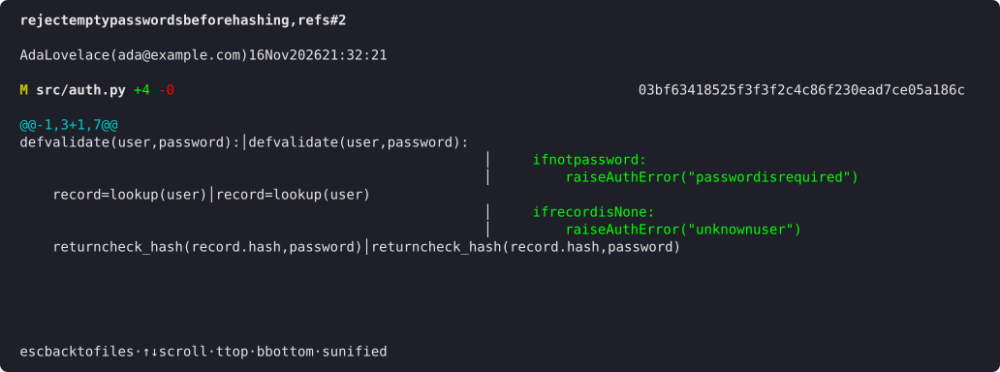

# KAN - The only Kanban app with a TUI

KAN is a terminal based project management tool that lives entirely in your repository. Jobs, comments and board settings are plain YAML files in a `.kan` folder, so they're versioned, branched and merged along with your code instead of sitting in an external site like Jira.



## Features

- **A kanban board in the terminal** - move between columns and jobs with the arrow keys, search with `/`, and open a job to edit it.
- **Jobs with details** - status, priority, assignee, description, comments and a history of changes.
- **Git integration** - mention `#12` in a commit message to link that commit to job 12. `fixes #12` (or closes, finishes, resolves) finishes the job as well.
- **Commits and diffs** - every job has a Commits tab listing the commits that reference it, with a unified or side by side diff of each file.
- **Branches** - press `g` on a job to switch to its branch (`12-fix-login-crash`), creating it if needed. Cards show `⎇` while a job has a branch and `⎇✓` once it's merged.
- **Live refresh** - the board picks up changes to the `.kan` files and git (a pull, a branch switch) without restarting.
- **Finishing and archiving** - strike jobs off with `f`, archive them with `x`, and bring either back later.
- **Theming** - column header colours and styles are set from the settings dialog (`s`) or in `kan.yaml`.
- **A command line interface** - `kan new`, `ls`, `mv`, `assign` and more work from the shell, so kan can be scripted from CI and git aliases.

### Job window



### Linked commits





## Building

KAN is C++20. The makefile uses `llvm@20` from Homebrew, but the Apple Clang that comes with Xcode works too.

```sh
brew install llvm@20 cmake
make build      # builds build/kan
make test       # builds and runs the tests
```

Dependencies ([termui](https://github.com/josh-orio/termui) and [yaml-cpp](https://github.com/jbeder/yaml-cpp)) are fetched by CMake.

## Usage

```sh
kan            # open the board in ./.kan, creating one if there isn't one
kan path/to/repo
```

Press `?` anywhere for the keys that work on that screen.

| Board | |
| --- | --- |
| `←↑↓→` | move between jobs |
| `o` / `↵` | open the selected job |
| `n` | new job in this column |
| `f` / `F` | finish a job / view finished jobs |
| `a` | view archived jobs |
| `/` | search titles, descriptions and #numbers |
| `s` | settings: columns and their styles |
| `q` | quit |

| Job window | |
| --- | --- |
| `tab` | next tab (Details, Commits, History) |
| `e` | edit title and description |
| `s` / `p` / `a` | set status, priority, assignee |
| `c` | add a comment |
| `↵` | on a comment or commit, read it in full / open it |
| `f` / `x` / `D` | finish, archive, delete |
| `g` | switch to the job's branch |

### Command line

```sh
kan new "Fix login crash" --priority high -a me
kan ls --assignee me
kan mv 12 done
kan comment 12 "Reproduced on staging"
kan finish 12
```

Jobs are given by number (`12` or `#12`), columns match without case by a unique start (`kan mv 12 dev`), and people by `me`, `none`, or part of a name or email. `kan ls` prints tab separated fields when piped. Run `kan help` for the full list.

### Linking commits

When kan makes a new board inside a git repo it adds a post-commit hook (respecting `core.hooksPath`), so commits that mention a job get linked to it. An existing shell hook is kept and the kan line is added to the end. Anyone cloning a repo that already has a board can add it themselves:

```sh
echo 'kan link-commit "$(git rev-parse HEAD)"' >> .git/hooks/post-commit
chmod +x .git/hooks/post-commit
```

## File structure

```
.kan/
├── kan.yaml            board title, columns and their styles
├── contributors.yaml   people who can be assigned jobs
├── style.yaml
└── jobs/               one YAML file per job, with its comments and linked commits
```

Commit the `.kan` folder with the rest of your repo.
